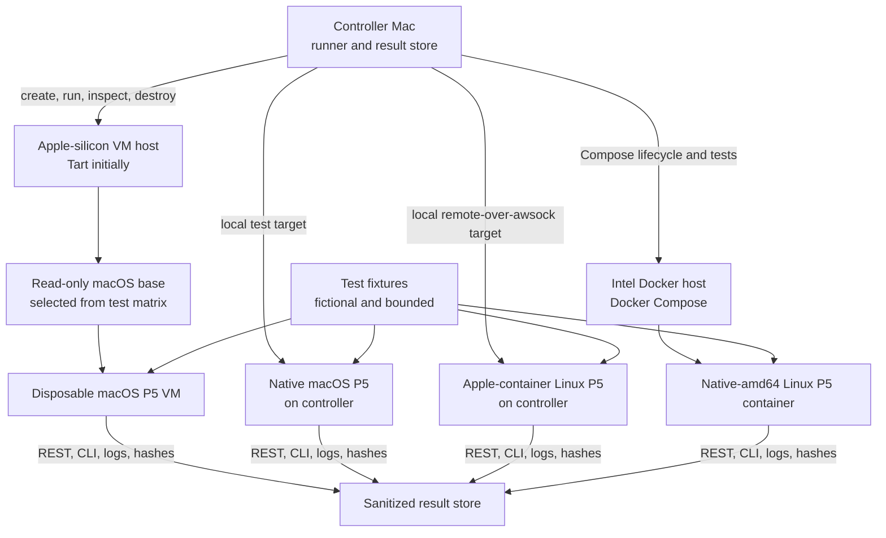

# macOS VM P5 Test Lab: Research and Roadmap

**Status:** Research and proposed roadmap only. No macOS VM image, P5 licence
automation, Archive configuration, or REST mutation workflow described here has
been implemented or accepted yet.

**Research date:** 2026-11-06

## Executive recommendation

Start with a small **Tart plus Packer** pilot using one disposable Apple
M-series macOS virtual machine within Archiware's published tested range. Build
an unlicensed golden macOS image, clone it for each test, install P5 into the
clone, run bounded installer and API checks, save sanitized receipts, and
discard the clone.

Use a dedicated Apple-silicon Mac as the initial macOS VM host, subject to its
installed memory, free storage, host OS, and supported guest matrix. A separate
controller can provide two additional P5 targets: native macOS P5 and an
Apple-container Linux P5 environment. An Intel Mac can provide a native-amd64
Docker Compose P5 target. This creates four useful execution contexts while
keeping hardware inventory out of shared configuration and documentation.

For a current pilot, use a macOS 27-capable Apple-silicon host running macOS 27
with separate macOS 15 and macOS 26.5 golden guest images. Run one guest at a
time on a 16-GB-class host. This arrangement is proposed, not yet accepted.

An 8-GB Apple-silicon host should begin with one small guest and avoid
concurrent VMs. A 16-GB host can begin with one 8-GB guest and may support two
reduced guests for short tests after measurement. For three or more concurrent
macOS guests, use a host with at least 32 GB RAM, preferably 64 GB, wired
Ethernet, and at least 500 GB free fast storage. Use Tart initially; evaluate
Anka when scheduling, shared templates, CI worker management, or multiple VM
hosts justify commercial infrastructure.

Keep **Parallels Desktop** available for a vendor-aligned reproduction lane.
The P5 8.0 manual explicitly lists Parallels as supported virtualization,
whereas Tart, UTM, and Anka are not named. Those tools are still valuable for
engineering tests, but a failure that may need Archiware support should be
reproduced in Parallels or on physical Apple hardware.

## Scope and desired outcome

The proposed lab should eventually be able to:

1. Create a known macOS guest from a reproducible base image.
2. Install a selected Archiware P5 macOS build without hand-editing the VM.
3. Verify P5 launch, reboot persistence, web access, REST access, and CLI access.
4. Activate a demo or trial licence only in an explicitly approved test guest.
5. Create a small, fictional Archive configuration and deterministic test data.
6. Exercise a few bounded Archive actions through the REST API.
7. Preserve machine-readable test receipts while excluding secrets and licence
   material.
8. Destroy or reset only the disposable resources owned by the test run.

The immediate milestone should stop after items 1 through 3. Licensing and
configuration writes belong in later, separately approved milestones.

## Generic host assessment

Record host inventory privately before assigning roles. Publish only the
capability class and accepted result unless an exact hardware characteristic is
necessary to reproduce a fault.

| Role | Minimum private assessment | Consequence |
| --- | --- | --- |
| Controller | Supported macOS, capacity for test tools and receipts | May also host native P5 and one local container target |
| Apple-silicon VM host | Chip family, memory, host OS, free fast storage, wired networking | Determines compatible guests and safe VM concurrency |
| Intel Docker host | Architecture, Docker environment, host OS, free storage | Provides native-amd64 comparison without ARM translation |
| Future fleet host | At least 32 GB RAM and 500 GB free fast storage | Better fit for three or more concurrent macOS guests |

### P5 macOS compatibility source

At the research date, Archiware's current P5 8.0.6 download page lists:

- Intel x86 (64-bit): macOS `10.9–15.x`;
- Apple M-series: macOS `11.x–26.5.x (Tahoe)`.

Treat the live download page as the current vendor-tested range; the P5 8.0
manual and older datasheets may lag it. Separate project testing has also
observed P5 working on macOS `27.2`. That newer result is useful compatibility
evidence, but it is outside Archiware's published range and must not be
described as vendor certification. Recheck the download page for each P5 and
macOS release rather than assuming forward compatibility.

### Proposed macOS 27 dual-guest pilot

The generic first pilot should use:

- an Apple-silicon VM host that Apple officially supports on macOS 27;
- macOS 27 on the host, enabling current Tart features including stacked
  images;
- one macOS 15 Sequoia golden guest for the established compatibility lane;
- one macOS 26.5 Tahoe golden guest at the upper end of Archiware's current
  published Apple M-series range;
- one running P5 guest at a time on a 16-GB-class host;
- 4 vCPU, 8 GB RAM, and a 60-80 GB sparse disk as the initial guest profile;
- at least 120-150 GB of free fast storage before downloading both base images
  and creating writable overlays.

Keep the two golden guests unlicensed. Create disposable writable clones for
installation and API testing. If a demo licence is later approved, apply it to
one explicitly stateful clone rather than either golden image. macOS `27.2`
native P5 testing remains a separate project-observed lane outside Archiware's
published range; it is not one of the two initial VM guest baselines.

## Options considered

| Option | Automation | Multi-VM efficiency | Best use here | Important limits |
| --- | --- | --- | --- | --- |
| **Tart + Packer** | Strong CLI, image, clone, guest-agent, and Packer workflows | Strong; stacked clones can reuse a remote base on supported hosts | Recommended engineering pilot and repeatable disposable guests | Not named in the P5 support matrix; headless startup can depend on an unlocked host login keychain |
| **Anka** | Strong CLI, registry, templates, tags, Packer, and CI integration | Strong; designed for managed macOS VM fleets | Dedicated multi-host lab or CI service | Commercial licensing; multiple running VMs require the appropriate edition; some snapshot capabilities differ by architecture |
| **UTM** | Useful `utmctl`, Shortcuts, and AppleScript control | Moderate | Hands-on debugging, visual inspection, and small manual labs | More desktop-oriented; template/fleet lifecycle requires more project-owned scripting |
| **Parallels Desktop** | Mature `prlctl` lifecycle and configuration commands | Moderate to strong | Vendor-aligned reproduction and acceptance lane | Commercial; on Apple silicon Parallels documents host/guest version constraints that must be checked for the chosen pairing |
| **VirtualBuddy** | Improving, but primarily GUI-oriented | Moderate | Fast exploratory macOS guests | Less suitable as the foundation of a reproducible automated test fleet |
| **Raw Virtualization.framework** | Complete control if a custom tool is built | Potentially strong | Future purpose-built `p5vm` tool | Highest engineering and maintenance cost; duplicates lifecycle work already supplied by Tart, Anka, and UTM |

### Why Tart is the recommended first step

Tart uses Apple's Virtualization framework, supplies a concise CLI, supports
pullable macOS base images, clone-based workflows, directory sharing, and a
guest agent capable of command execution without depending on guest SSH or
network setup. Packer's Tart builder can build from an IPSW or an existing
base VM and set CPU, memory, disk, headless mode, and networking options.

On supported newer macOS hosts, stacked clones use an immutable base with a
private overlay, reducing duplicate storage. That is valuable for disposable
test guests, although it does not remove the need for substantial free space
for the first image, overlays, P5 installers, fixtures, and logs.

### When Anka becomes worthwhile

Anka becomes the stronger candidate when the lab needs a shared registry,
template tags, schedulable workers, concurrent CI jobs, or more than one VM
host. Its added operational structure comes with licensing and administration
costs. It should be evaluated after the test image and P5 automation have been
proven with one guest, so the project can distinguish P5 automation problems
from fleet-management problems.

### Roles for UTM and Parallels

UTM is a good inspection and debugging tool. Its command-line interface can
start disposable guests, clone and delete VMs, run guest commands when the
guest agent is present, transfer files, obtain IP addresses, and manage
snapshots. It is a practical alternative if a GUI-first workflow is preferred.

Parallels should be used for a smaller acceptance lane because it is explicitly
listed in the P5 documentation. It does not need to be the high-volume runner.
A representative installer, service, API, and Archive test can be repeated in
Parallels before declaring a P5/macOS combination accepted.

## Proposed architecture



### Planned three-host roles

| Physical host | Planned targets | Primary purpose | Initial automation |
| --- | --- | --- | --- |
| Controller Mac | Native macOS P5; Apple-container Linux P5 | Command Lab client, local/native comparison, Apple-container acceptance | Existing native P5 procedures plus this repository's Apple-container scripts |
| Apple-silicon VM host | One or more Apple M-series macOS P5 guests | Disposable macOS installer, upgrade, licensing, and Archive tests | Tart/Packer pilot; Parallels reproduction where required |
| Intel Docker host | Linux P5 container using Docker Compose | Native x86-64 container comparison without ARM translation | Docker Compose lifecycle, health, REST, CLI, and fixture tests |

This layout separates processor architecture, guest operating system, and P5
packaging so a failure can be narrowed more quickly. It also avoids treating
success in the Linux container as proof that native macOS P5 works, or treating
an ARM macOS guest result as proof of the Intel Docker path.

Keep the lab network private and use stable fictional DNS aliases or an
inventory file rather than embedding LAN addresses in scripts. Expose only the
interfaces needed by the controller. The Intel Docker Compose service should
publish distinct host REST and CLI ports to container ports `8000` and `9001`,
following this repository's established mapping. Validate the exact Docker
Desktop or Docker Engine environment on that Intel Mac before recording it as
accepted; the existing Linux Docker acceptance result does not automatically
cover Docker Desktop on macOS.

### Command Lab profile and connection rules

Create a clearly named profile for every target and never infer the execution
mode from a friendly display name:

| Target type | Host field | CLI mode |
| --- | --- | --- |
| Native P5 installed on the controller Mac | Loopback | Local CLI only when intentionally testing the controller's installed P5 |
| Apple-container P5 on the controller Mac | Loopback with mapped REST/CLI ports | Remote over awsock, because P5 is inside the container |
| macOS P5 guest | Private lab DNS name or assigned address | Remote over awsock |
| Intel Docker Compose P5 | Private lab DNS name or assigned address | Remote over awsock through the published CLI port |

Any profile whose P5 process is not the controller Mac's native P5 service must
use remote-over-awsock, including a container reached through loopback. This
prevents a CLI command intended for a container or guest from silently running
against the controller's installed P5.

## Image and guest lifecycle

### Golden base image

The golden image should contain only:

- a selected macOS installation from the documented test matrix;
- a dedicated, fictional automation account;
- the selected VM guest agent or SSH configuration;
- current OS updates chosen for that test matrix;
- a small bootstrap script and trusted test-runner public key, if required.

It should not contain P5, an activated P5 licence, production credentials,
customer data, production hostnames, or permanent API secrets.

### Per-test clone

Each test should:

1. Clone or layer a uniquely named guest from the immutable base.
2. Start it with an explicit CPU, memory, disk, and network profile.
3. Wait for the guest agent or SSH readiness with a bounded timeout.
4. Attach or copy a checksum-verified P5 installer and fictional fixtures.
5. Install P5 and record installer output, product version, service state, and
   reboot persistence.
6. Run the milestone's authorized API and CLI checks.
7. Export sanitized logs, receipts, and hashes.
8. Stop and delete the clone unless the run is explicitly retained for
   diagnosis.

Never activate a golden image. Cloning an activated guest may duplicate a
licensed machine identity or create ambiguous activation state. Confirm the
trial-licence rules and the identity fields used by P5 with Archiware before
automating any licensed clone lifecycle.

## Suggested resource profiles

These are starting points to validate, not guaranteed P5 sizing guidance.

| Profile | vCPU | Guest RAM | Guest disk | Intended use |
| --- | ---: | ---: | ---: | --- |
| Installer smoke test | 4 | 8 GB | 60 GB sparse | Install, reboot, web, REST, and CLI checks |
| Small licensed Archive test | 4 | 8-12 GB | 80-120 GB sparse | P5 database, small disk Archive volume, archive/restore fixture |
| Two-guest interaction test | 4 each | 6-8 GB each | 60-80 GB each | Occasional server/client or upgrade checks on a 32-GB-or-larger host |
| Multi-VM lab | 4 each | 8-12 GB each | 80-120 GB each | Three or more guests on a 64-GB-class dedicated host |

Sparse disks still consume real capacity as data is written. Maintain a free
space threshold and refuse to create a guest when the host would fall below it.
Do not place the only copy of test receipts inside a disposable VM.

Before fixing an Apple-silicon VM-host profile, privately record its memory,
internal free space, macOS version, Ethernet availability, and whether VM
storage will be internal or on a fast external NVMe. Those values determine
whether it is a one-guest host or can safely run two short-lived guests.

## Phased implementation roadmap

### Phase 0: research and guardrails

This document completes the initial research deliverable. Before building the
pilot, confirm:

- the exact P5 version and the current vendor-tested macOS range;
- the Apple software licence terms for the exact guest release;
- Archiware's current demo/trial licence rules and machine-identity behaviour;
- whether the first host will use internal storage or a fast external NVMe;
- the private network and DNS naming convention for disposable guests.

### Phase 1: unlicensed installation automation

Build the selected golden macOS image and a disposable-clone runner. Automate
only:

- P5 installer checksum and signature verification;
- unattended package installation where the vendor installer supports it;
- service and process discovery;
- web endpoint readiness;
- read-only REST server information;
- read-only CLI server information;
- reboot and post-reboot readiness;
- bounded uninstall or clone disposal.

Acceptance requires repeated clean runs, useful failure logs, no embedded
credentials, and proof that cleanup cannot target anything outside the named
test guest.

### Phase 2: demo/trial licensing

Add a confirmation-gated licence step. Prefer one explicitly stateful licensed
guest at first rather than cloning a licensed image. Store licence material
outside Git and outside the golden image, using Keychain or another approved
secret store. Record only a redacted licence state in test receipts.

Automation must stop safely if activation fails, the licence is expired, the
guest identity differs from the approved target, or the licence agreement does
not permit the proposed reset/reuse model.

### Phase 3: basic P5 Archive configuration

Create a minimal, fictional configuration, for example:

- Archive index: `Example-Archive`
- Archive plan: `Example-Plan`
- Disk storage or pool: `TEST-POOL`
- Source: `/Users/example/P5-Test/Source`
- Restore destination: `/Users/example/P5-Test/Restored`
- Archive storage: a dedicated small virtual disk or owned test directory

The setup tool should use an idempotent **ensure state** model: read the
current object, create it only when absent, update only approved fields, then
read it back and compare it with the desired state. Exact endpoint names and
request bodies must be derived from and tested against the installed P5
version; this roadmap intentionally does not invent undocumented write calls.

### Phase 4: REST automation framework

Implement a small test runner that provides:

- version and licence preflight;
- credentials supplied at runtime from Keychain or environment injection;
- explicit connect and request timeouts;
- bounded job polling with a terminal-state deadline;
- redaction of authorization headers, passwords, licence strings, and tokens;
- before-state, request intent, response status, after-state, and job-ID
  receipts;
- an idempotent rerun mode;
- a dry-run or plan view before configuration mutations;
- a unique run ID tied to the VM identity and P5 version.

A suggested receipt shape is:

```json
{
  "run_id": "example-run-001",
  "vm_id": "p5-macos-example-001",
  "p5_version": "<observed-version>",
  "operation": "ensure_archive_plan",
  "target": "Example-Plan",
  "before": "<sanitized-state>",
  "result": "<sanitized-result>",
  "after": "<sanitized-state>",
  "job_id": "<if-returned>",
  "timestamp_utc": "<ISO-8601>"
}
```

### Phase 5: bounded Archive actions

Generate a deterministic fixture containing a few small files, nested paths,
Unicode names, fixed random data, and a SHA-256 manifest. Then:

1. Archive the owned fixture through `Example-Plan`.
2. Capture and poll the returned job identifier to a terminal state.
3. Confirm the resulting ArchiveEntry or equivalent P5 record.
4. Restore into a new, empty, run-owned directory.
5. Compare file count, paths, sizes, and SHA-256 hashes.
6. Save sanitized results before any cleanup.

No test should overwrite its source, restore into an existing directory, use a
production plan, or delete an Archive record unless that destructive operation
is a separately approved test with its own disposable storage.

## Acceptance gates

| Gate | Required evidence |
| --- | --- |
| VM base | Guest OS/version, image provenance, checksum, successful clean boot |
| P5 installation | Installer result, signature assessment, observed P5 version, service state |
| Connectivity | Web, read-only REST, and read-only CLI from the controller |
| Reboot | P5 returns to ready state within a documented timeout |
| Licensing | Approved target identity, redacted state, no secret in image/repository/receipt |
| Configuration | Before/after reads match the fictional desired state and rerun is idempotent |
| Archive | Terminal job status, Archive record, restored fixture, matching hashes |
| Disposal | Named clone removed; base image, other VMs, and host data unchanged |
| Reproduction | Representative accepted test repeated in Parallels or on physical supported hardware |

Keep these result categories separate: build success, guest boot, P5 install,
unlicensed API access, licensed configuration, Archive movement, multi-VM
concurrency, and vendor-supported reproduction. Passing one does not imply the
others.

## Risks and unresolved questions

- **Apple licence limits:** Apple's macOS licence terms have historically
  limited additional virtual macOS instances on Apple-branded hardware. Verify
  the agreement for the exact host and guest releases before selecting a
  concurrency target.
- **P5 support boundary:** the current P5 8.0.6 download page lists Apple
  M-series macOS `11.x–26.5.x (Tahoe)`. Project testing has observed operation
  on macOS `27.2`, but that remains outside Archiware's published tested range.
  Keep vendor-tested and project-observed results distinct.
- **Virtualization support:** Parallels is named by Archiware; Tart, UTM, and
  Anka are engineering platforms unless Archiware confirms otherwise.
- **Licence identity:** snapshots and clones may preserve or duplicate identity
  state. Do not automate reset, cloning, or reactivation until Archiware
  confirms permitted behaviour.
- **Headless startup:** Virtualization-framework guests may depend on an
  unlocked host login keychain on some host releases. Validate restart and
  unattended-boot behaviour before treating a laptop or remote Mac as a lab
  server.
- **Storage growth:** base images and sparse overlays grow. Enforce quotas,
  retention, and free-space preflight.
- **Networking:** NAT is simplest; bridged guests make stable service access
  easier but increase exposure. Bind or firewall P5 endpoints to the lab
  network only.
- **Secrets:** P5 credentials and licences must never enter VM templates,
  shell history, Git, screenshots, or unredacted logs.
- **REST drift:** P5 endpoints and bodies can change by version. Discover and
  validate against the installed server before enabling writes.

## Decision path

1. Privately inventory the proposed Apple-silicon and Intel hosts: memory,
   host OS, free space, Docker or VM-tool support, and wired networking.
2. Provide at least 150 GB of fast free storage for both bases and the first
   disposable overlays.
3. On a macOS 27-capable Apple-silicon host, prepare separate macOS 15 and
   macOS 26.5 golden guests using current Tart stacked images.
4. Accept installer, reboot, REST, and CLI tests on one disposable macOS 15
   clone, then repeat them on a macOS 26.5 clone.
5. Deploy the existing Docker Compose design on the Intel Docker host, adjust
   only host paths and ports, and run a new Intel-macOS-host acceptance record.
6. Register all four P5 targets in Command Lab and prove that each remote
   profile reaches the intended server identity through REST and CLI.
7. Repeat the representative macOS VM smoke test in Parallels.
8. Obtain written clarity on demo/trial activation and clone behaviour.
9. Add one stateful licensed guest and the fictional Archive configuration.
10. Implement and accept the bounded archive/restore/hash workflow.
11. Move to a 32/64-GB Apple-silicon VM host and evaluate Anka only when
    concurrent demand justifies it.

## Primary references

- Archiware: [Current P5 downloads and tested operating-system ranges](https://www.archiware.com/download-p5/)
- Apple: [Mac models compatible with macOS 27](https://support.apple.com/en-us/127255)
- Apple: [Installing macOS on a virtual machine](https://developer.apple.com/documentation/virtualization/installing-macos-on-a-virtual-machine)
- Apple: [Virtualize macOS on a Mac](https://developer.apple.com/documentation/virtualization/virtualize-macos-on-a-mac)
- Apple: [macOS Ventura software licence agreement](https://www.apple.com/legal/sla/docs/macOSVentura.pdf) (example wording only; verify the exact installed release)
- Tart: [Quick start](https://github.com/openai/tart/blob/main/docs/quick-start.md)
- Tart: [Frequently asked questions](https://github.com/openai/tart/blob/main/docs/faq.md)
- Tart: [Guest agent](https://github.com/openai/tart/blob/main/docs/blog/posts/2025-06-01-tart-guest-agent.md)
- HashiCorp: [Packer Tart builder](https://developer.hashicorp.com/packer/integrations/cirruslabs/tart/latest/components/builder/tart)
- UTM: [Scripting and command-line automation](https://docs.getutm.app/scripting/scripting/)
- UTM: [macOS guest support](https://docs.getutm.app/guest-support/macos/)
- Parallels: [Create a VM with `prlctl`](https://docs.parallels.com/landing/parallels-desktop-developers-guide/command-line-interface-utility/manage-virtual-machines-from-cli/general-virtual-machine-management/create-a-virtual-machine)
- Anka: [Documentation](https://docs.veertu.com/anka/)
- Anka: [Supported macOS versions](https://docs.veertu.com/anka/anka-virtualization-cli/getting-started/creating-vms/supported-macos-versions/)
- Anka: [Licensing](https://docs.veertu.com/anka/licensing/)
- VirtualBuddy: [Releases and automation-related changes](https://github.com/insidegui/VirtualBuddy/releases)
- Archiware: [P5 8.0 manual](https://www.archiware.com/sites/default/files/2026-01/P5_Manual_EN_8.0.pdf)
